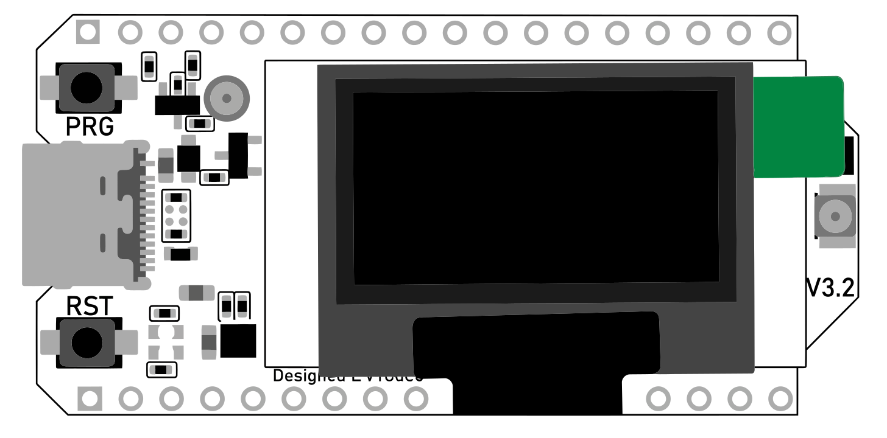

# MeshCore СПб — прошивальщик нод

## Цель проекта

Статический веб-прошивальщик нод MeshCore для сообщества Санкт-Петербурга.
Базируется на <https://github.com/meshcore-dev/flasher.meshcore.io> (MIT).
Должен работать из подкаталога `https://meshcore.spb.ru/flasher/` без сборки,
без npm и без внешних CDN.

## Источники и ссылки

- Оригинальный флашер: <https://github.com/meshcore-dev/flasher.meshcore.io>
- Оригинальный сайт: <https://flasher.meshcore.io>
- Wiki СПб: <https://meshcore.spb.ru/wiki/>
- Рекомендуемые прошивки (исходные ZIP на wiki): <https://meshcore.spb.ru/wiki/experiment>
- Рекомендуемые настройки репитера: <https://meshcore.spb.ru/wiki/repeater-specific>
- Инструкция по прошивке: <https://meshcore.spb.ru/wiki/repeater>
- Конфигуратор (не менять ссылку): <https://config.meshcore.io>

## Принятые решения

- Хостинг: `meshcore.spb.ru/flasher/`, тот же origin, что и wiki.
- Прошивки **не копируются** в проект: `config.json` ссылается на ZIP-архивы
  в `/wiki/_media/wiki/files/`, браузер скачивает и распаковывает их.
- Распаковка: `lib/zip.min.js` — это `zip.js` (`ZipReader`, `BlobReader`,
  `BlobWriter`), не JSZip. Отдельная библиотека не нужна.
- Каталог: прошивки с wiki — рекомендуемые (репитер и наблюдатель) во всех доступных версиях и вариантах.
- Мосты ESPNow — не отдельные устройства: у Heltec v4 это класс `bridge`,
  у MTL-1 — `mtl1-868-bridge` / `mtl1-433-bridge`. MTL-1/MTL-2 — одна
  плата с отдельными блоками 868/433.
- Официальные companion-прошивки с flasher.meshcore.io пока **отложены**:
  официальный сайт не отдаёт CORS, нужен same-origin proxy или зеркало.
- Сценарий: **устройство → роль → версия → прошивка**.
- Язык интерфейса: русский.
- Тема: только светлая, палитра и логотип с wiki.
- Ссылка «Настройка репитера» / «Configure via USB» остаётся
  `https://config.meshcore.io` (открывается в popup, как в оригинале).
- Встроенная последовательная консоль остаётся оригинальной (переводятся
  только подписи). Команды уходят с одним `\r`: прошивки MeshCore режут
  строку по CR, и при `\r\n` остаётся пустая строка, на которую нода
  отвечает `Unknown command`.
- Custom Firmware (`.bin` для ESP32, OTA `.zip` для nRF52) остаётся.
- Предупреждения: observer + смена типа прошивки.
- Observer требует обязательный чекбокс подтверждения перед прошивкой.
- Компаньоны с wiki добавлены: роль `companionBle`, во всех блоках
  идёт **первой**, затем репитер, затем наблюдатель. У MTL-блоков роли
  отдельные (`mtl1_868_companion`, `mtl1_433_companion`,
  `mtl2_868_companion`, `mtl2_433_companion`). `companionUsb` остаётся
  зарезервированной.
- Donate, welcome-banner, YouTube-баннер и zephcore-режим удаляются.
- `?config=` и `?iframe=` не нужны.
- Яндекс.Метрика: счётчик `108159015`, тот же, что на wiki; сниппет в
  `index.html` перед `</body>`, обёрнут в
  `if (location.hostname !== 'meshcore.spb.ru') return;`, чтобы
  локальные проверки не попадали в боевую статистику. `noscript`-пиксель
  `https://mc.yandex.ru/watch/108159015` добавлен без условия.

- Генерация конфига: основной путь — `tools/build-config.sh`, он читает
  папку с ZIP на хосте и таблицы `tools/catalog.*`; всё, что выводится
  из имени архива (`<токен>[_bridge_espnow][_mqtt]-v<версия>[_суффикс]`),
  выводится из него. Python-цепочка (`firmware-manifest.json` +
  `build_config.py`) оставлена резервным путём; `build_config.py --tables`
  пересобирает таблицы из манифеста, чтобы пути не расходились.
  `--check` у bash-скрипта сравнивает результат с `config.json` и
  возвращает 1, если тот устарел; незнакомые файлы дают предупреждение,
  а с `--strict` — ошибку. Внутрь ZIP скрипт не заглядывает.
- `tools/catalog.common.json` — фрагмент `role`/`firmwareClass`/`notice`
  уже в том виде, в каком он попадает в `config.json` (отступ 2 пробела,
  последняя строка с запятой); bash-скрипт вставляет его как есть.
- Замыкание двух путей: `python3 tools/build_config.py --tables`
  пересобирает все `tools/catalog.*` из манифеста, поэтому расхождение
  лечится одной командой. Проверено: таблицы, собранные скриптом, и
  `config.json`, собранный по ним, байт-в-байт совпадают с результатом
  python-пути.

## Архитектура

- Чистая статика: `index.html`, `flasher.js`, `js/*`, `lib/*`, `css/*`,
  `img/*`, `firmware/*`, `config.json`.
- ES-модули, Vue 3, BeerCSS — как в upstream.
- Все пути относительные. Сайт должен работать из любого подкаталога.
- Вместо path-роутинга и серверного `try_files` используется hash-роутинг:
  `#/heltec-v3/repeater/v1.18-bl-ps-ts`, `#/console`.
- `config.firmwareBase` = `../wiki/_media/wiki/files/` (резолвится от
  `document.baseURI`).
- Загрузчик ZIP:
  1. `fetch` архива с прогрессом по `Content-Length`;
  2. `ZipReader` + `BlobReader`;
  3. выбор entry по regex из `files[].match`;
  4. `BlobWriter` → `Blob`;
  5. кэш в памяти, чтобы «Прошить ещё раз» не качал заново.
- Если сайт переедет на другой домен, достаточно поменять `firmwareBase`
  на локальную папку `firmware/` (режим предусмотреть, но не включать).

## Структура проекта

```text
index.html
flasher.js
config.json
AGENTS.md
README.md
LICENSE
css/
  beer.css              # локальный BeerCSS + локальный шрифт иконок
  theme.css             # палитра СПб, светлая тема, базовые элементы
  flasher.css           # layout и компоненты флашера
js/
  app.js                # Vue setup, состояние, сценарии
  catalog.js            # загрузка и представление каталога
  commands.js           # справка команд консоли (из upstream)
  firmware.js           # чистые функции выбора файлов (тестируемые)
  flash.js              # ESP32 / nRF52 / custom firmware
  router.js             # hash-роутинг
  serial.js             # Web Serial + Android polyfill
  site.js               # константы сайта
  util.js               # мелкие утилиты
  zip-loader.js         # fetch + zip.js + кэш
lib/
  beer.min.js
  vue.min.js
  console.js
  dfu.js
  esp32.js
  zip.min.js
  polyfill/serial.js
  material-symbols-outlined.woff2
firmware/
  FLASH_ERASE_nrf52_softdevice_v6.zip   # стирание flash nRF52 (DFU)
  FLASH_ERASE_nrf52_softdevice_v6.uf2   # то же для drag & drop
img/
  logo.png              # логотип с wiki (256x256)
  esp32.svg, nrf52.svg, esp_now.svg, faketec.svg,
  mtl_1.webp, mtl_2_868.webp, mtl_2_433.webp
  heltec_v3.svg, heltec_v4.svg, heltec_t096.svg, heltec_t114.svg,
  lilygo_tbeam.svg, gatiot_gat562_30s.svg
tools/
  build-config.sh        # папка с ZIP → config.json (bash, основной путь)
  catalog.devices.tsv    # таблица плат
  catalog.versions.tsv   # таблица версий
  catalog.filesets.tsv   # наборы файлов внутри ZIP
  catalog.common.json    # role / firmwareClass / notice
  firmware-manifest.json # резервный источник истины
  build_config.py        # manifest → config.json; --tables → catalog.*
  check_config.py
  test_build_config.py
tests/
  build-config.test.sh
  firmware.test.mjs
```

## Схема config.json

```json
{
  "firmwareBase": "../wiki/_media/wiki/files/",
  "role": {
    "repeater": { "icon": "cell_tower", "title": "Репитер", "tooltip": "..." },
    "observer": { "icon": "sensors", "title": "Наблюдатель", "tooltip": "..." },
    "companionBle": { "icon": "smartphone", "title": "Компаньон", "subTitle": "Bluetooth" },
    "companionUsb": { "icon": "usb", "title": "Компаньон", "subTitle": "USB" }
  },
  "firmwareClass": {
    "spb": { "title": "Рекомендуемые прошивки", "tooltip": "..." }
  },
  "notice": {
    "observer": "<article>...</article>",
    "switchType": "<article>...</article>"
  },
  "device": [
    {
      "name": "Heltec v3",
      "maker": "heltec",
      "type": "esp32",
      "icon": "img/heltec_v3.svg",
      "tooltip": "",
      "firmware": [
        {
          "class": "spb",
          "role": "repeater",
          "version": {
            "v1.18 · BL+PS+TS": {
              "archive": "heltec_v3_repeater-v1.18-bl-ps-ts.zip",
              "notes": "...",
              "files": [
                { "type": "flash-wipe", "match": "-merged\\.bin$", "title": "merged — с очисткой данных" },
                { "type": "flash-update", "match": "^(?!.*-merged\\.bin$).*\\.bin$", "title": "upgrade — обновление" }
              ]
            }
          }
        }
      ]
    }
  ]
}
```

Для nRF52:

```json
"files": [
  { "type": "flash", "match": "\\.zip$", "title": "OTA-пакет" },
  { "type": "download", "match": "\\.uf2$", "title": "UF2 для ручного DFU" }
]
```

`version` — объект: ключей может быть несколько, у каждой версии свой
`archive`, `notes` и `files`. Для ESP32 update-файл выбирается как
не-merged `.bin`; это покрывает и `-upgrade.bin`, и старые `...-hash.bin`:

```text
^(?!.*-merged\.bin$).*\.bin$
```

## Состав каталога

| Устройство | Тип | Компаньон | Репитер | Наблюдатель |
|---|---|---|---|---|
| Heltec v3 | ESP32 | ✓ | ✓ | ✓ |
| Heltec v4 | ESP32 | ✓ | ✓ | ✓ |
| LilyGo T-Beam SX1262 | ESP32 | ✓ | ✓ | — |
| LilyGo T-Beam SX1276 | ESP32 | ✓ | ✓ | — |
| Heltec Mesh Node T096 | nRF52 | ✓ | ✓ | — |
| Heltec Mesh Node T114 | nRF52 | ✓ | ✓ | — |
| GAT562 30s Kit | nRF52 | ✓ | ✓ | — |
| ProMicro nRF52 (fakeTec) | nRF52 | ✓ | ✓ | — |
| MTL-1 | ESP32 | ✓ | ✓ | ✓ |
| MTL-2 | nRF52 | ✓ | ✓ | — |
| Elecrow ThinkNode M1 | nRF52 | ✓ | — | — |
| Elecrow ThinkNode M5 | ESP32 | ✓ | — | — |
| GAT-IoT GAT562 Tracker | nRF52 | ✓ | — | — |
| Heltec MeshPocket | nRF52 | ✓ | — | — |
| Heltec Wireless Paper | ESP32 | ✓ | — | — |
| LilyGo T-Beam 1W | ESP32 | ✓ | ✓ | — |
| LilyGo T-Echo | nRF52 | ✓ | — | — |
| LilyGo T-Echo Lite | nRF52 | ✓ | — | — |
| RAK WisBlock 4631 | nRF52 | ✓ | — | — |
| RAK WisMesh Tag | nRF52 | ✓ | — | — |
| Seeed Studio SenseCAP T1000-E | nRF52 | ✓ | — | — |
| Seeed Studio Wio Tracker L1 Pro | nRF52 | ✓ | — | — |
| Seeed Studio Xiao nRF52 WIO | nRF52 | ✓ | — | — |

Итого: 23 устройства, 48 записей прошивок, **103 версии** (компаньоны `v1.18 · PS`, репитеры BL+PS/BL+PS+TS/PR2343, v1.16/v1.17.1, observer CAD).

У MTL-1/MTL-2 внутри устройства отдельные блоки:
`mtl1-868`, `mtl1-433`, `mtl1-868-bridge`, `mtl1-433-bridge`;
у MTL-2 — `mtl2-868`, `mtl2-433`. У Heltec v4 мост остаётся классом
`bridge` (`bridgeRepeater` / `bridgeObserver`).

## ZIP-архивы

Полный список — в `tools/firmware-manifest.json`: **103 архивов**.
Ниже — примеры имён для рекомендованного варианта `v1.18 · BL+PS+TS`.
Другие версии используют суффиксы `-v1.18-bl-ps`, `-v1.18-pr2343`,
`-v1.17.1-pr2343`, `-v1.16-pr2343`; observer — `mqtt-v1.18`,
`mqtt-v1.16`, `mqtt-v1.16_cad`; компаньоны — `-companion_radio_ble-v1.18-ps`.

Репитер (ESP32, внутри `*-freshInstall-merged.bin` + update `.bin`):

- `heltec_v3_repeater-v1.18-bl-ps-ts.zip`
- `heltec_v4_repeater-v1.18-bl-ps-ts.zip`
- `tbeam_sx1262_repeater-v1.18-bl-ps-ts.zip`
- `tbeam_sx1276_repeater-v1.18-bl-ps-ts.zip`
- `mtl_1_repeater-v1.18-bl-ps-ts.zip`
- `mtl_1_sx1268_repeater-v1.18-bl-ps-ts.zip`
- `heltec_v4_repeater_bridge_espnow-v1.18-bl-ps-ts.zip`
- `mtl_1_repeater_bridge_espnow-v1.18-bl-ps-ts.zip`
- `mtl_1_sx1268_repeater_bridge_espnow-v1.18-bl-ps-ts.zip`

Репитер (nRF52, внутри `.uf2` + OTA `.zip`):

- `heltec_t096_repeater-v1.18-bl-ps-ts.zip`
- `heltec_t114_repeater-v1.18-bl-ps-ts.zip`
- `gat562_30s_mesh_kit_repeater-v1.18-bl-ps-ts.zip`
- `promicro_repeater-v1.18-bl-ps-ts.zip`
- `mtl_2_e22_sx1262_repeater-v1.18-bl-ps-ts.zip`
- `mtl_2_e22_sx1268_repeater-v1.18-bl-ps-ts.zip`

Наблюдатель (ESP32, внутри `*-merged.bin` + обычный `.bin`):

- `heltec_v3_repeater_mqtt-v1.18.zip`
- `heltec_v4_repeater_mqtt-v1.18.zip`
- `mtl_1_repeater_mqtt-v1.18.zip`
- `mtl_1_sx1268_repeater_mqtt-v1.18.zip`
- `heltec_v4_repeater_bridge_espnow_mqtt-v1.18.zip`
- `mtl_1_repeater_bridge_espnow_mqtt-v1.18.zip`
- `mtl_1_sx1268_repeater_bridge_espnow_mqtt-v1.18.zip`

## Логика прошивки

### ESP32

- `Erase device` выключен → `flash-update` (update-файл: `upgrade.bin` или старый `...-hash.bin`), адрес `0x10000`.
- `Erase device` включён → `flash-wipe` (`*-merged.bin`), адрес `0`, `eraseAll: true`.
- Прошивка через `lib/esp32.js` (esptool.js), как в upstream.
- После успеха — «Настроить через USB» → `https://config.meshcore.io`.

### nRF52

- «Enter DFU mode» — `Dfu.forceDfuMode`, как в upstream.
- Прошивка внутренним OTA `.zip` из архива через `Dfu.dfuUpdate`.
- `.uf2` — только для скачивания / ручного DFU.
- Платы с USB-serial мостом (T096/T114) помечены `"dfu": "manual"`:
  кнопка «Войти в DFU» скрыта, вход в DFU — двойной RST. После этого
  работают оба пути: serial DFU по кнопке «Прошить!» и UF2 drag & drop.
- Отдельной очистки flash в wiki-архивах нет, поэтому для nRF52 добавлена
  кнопка «Стереть flash»: официальный пакет
  `firmware/FLASH_ERASE_nrf52_softdevice_v6.zip` (с flasher.meshcore.io)
  кладётся через DFU, а `.uf2` того же пакета лежит рядом для drag & drop
  и доступен в меню «Скачать». Файлы хостятся у нас, не с официального
  сайта (там нет CORS).
- Для nRF52 в блоке пояснения — ссылка на <https://meshcore.spb.ru/wiki/nrf52>
  и рекомендация OTAFIX bootloader (стабильный OTA).
- После успеха — «Настроить через USB» для роли репитера/наблюдателя.

### Custom firmware

- `.bin` → ESP32; OTA `.zip` → nRF52.
- Если имя заканчивается на `merged.bin` — предупредить, что это стирает flash.

### Ошибки

Понятные русские сообщения: нет сети, битый ZIP, нет подходящего файла,
браузер без Web Serial, ошибка инициализации/прошивки. Кнопки «Повторить»
и «Закрыть».

## UI и тема

- Палитра: фон `#f5f5f5` (как на вики), surface `#ffffff`, primary `#0042aa`,
  primary-container `#e3edff`, accent `#f26a21`, текст `#10233f`,
  outline `#c3d0e3`.
- Скругления: один токен `--spb-radius: 3px` (в `theme.css`). Карточки,
  панели, чипы, кнопки, поля и консоль используют его; пилюли BeerCSS
  (`1.25rem` у кнопок, `2rem` у подсказок, `999px` у чипов)
  переопределены. Круглыми остались только чекбоксы/переключатели
  и спиннер загрузки.
- Шрифт: `Arial, sans-serif` — как на вики (`--font` в `theme.css`),
  база 14 px. `-webkit-font-smoothing` не включаем, чтобы плотность
  текста совпадала с вики. Заголовки остаются цветными (navy) — это
  единственное отличие от чёрного текста вики, фирменный вид.
- Шапка и `.screen-header` прозрачные: BeerCSS красит любой `header`
  в `--surface-container`, поэтому сквозь них виден фон страницы,
  как на вики.
- Высота шапки одинаковая на всех экранах: на ≤720 px бренд занимает
  первую строку (`flex: 1 0 100%`), кнопки — вторую. Иначе появление
  третьей кнопки «Кастомная» на главной переносило строку и шапка
  прыгала (121 px против 93 px).
- Шапка: `logo.png` 58 px (на мобильном 48 px) + текст
  «MeshCore Санкт-Петербург» (`.site-header` с `padding-inline: 24px`,
  поэтому логотип выровнен с текстом внутри карточек),
  подпись «Прошивальщик нод». Шапка видна на всех экранах;
  логотип и название ведут на главную прошивальщика (`#/`).
- Логотип — тот же файл, что на wiki (`/wiki/_media/wiki/logo.png`,
  SHA-1 `c23957b6…`), PNG с альфа-каналом. У `.brand-logo` нет ни
  `background`, ни `box-shadow`, ни `border-radius` — картинка лежит на
  фоне шапки как есть, без плашки и тени.
- Радио-параметры (`868.856 МГц · BW 62.5 · SF7 · CR7 · 2b`) на главной
  не показываются: вместо чипа стоит ссылка «Настройки сети» на
  <https://meshcore.spb.ru/wiki/settings>.
- Главный экран: поиск, список устройств с иконками, кнопки
  «Кастомная прошивка», «Настройка репитера», «Консоль». Пояснение
  «здесь только репитеры и наблюдатели, компаньон — на официальном
  сайте» убрано: компаньоны теперь в каталоге.
- Порядок ролей в блоке: компаньон → репитер → наблюдатель; мосты
  ESPNow по-прежнему отдельным блоком в конце.
- На экране компаньона `.settings-link` показывает только
  «Настройки сети» (без «Рекомендуемых» и без чипа наблюдателя).
- «Настройка» и «Консоль» доступны в шапке на всех экранах;
  «Кастомная» — только на главной.
- Экран устройства: роли с иконками и описаниями.
- Экран прошивки: версия, notes, предупреждения, чекбокс очистки,
  кнопка «Прошить!», скачивание.
- Observer: предупреждение + обязательный чекбокс
  «Понимаю, что прошивка предназначена для CoreScope Санкт-Петербурга».
  Кнопка «Прошить!» disabled, пока чекбокс не отмечен.
  Чекбокс сбрасывается при смене устройства/роли/версии.
- Смена типа: предупреждение «сохраните настройки и приватные ключи,
  используйте merged, затем восстановите».
- Адаптив: 320 px, 768 px, десктоп. На мобильных скрывать крупные
  изображения и tooltip’ы.
- Material Symbols Outlined — локально, без jsDelivr.
- Классы прошивок: «Рекомендуемые прошивки» и «Мосты ESPNow».
- Bridge-роли: `bridgeRepeater` / `bridgeObserver`, bridgeObserver требует
  observer-чекбокс.
- Футер — общий для всех экранов (лежит в `.flash-container`, не внутри
  главной; не виден только под оверлеем консоли). Одна строка обычных
  ссылок: «О прошивках» (`/wiki/experiment`), «Настройки сети»
  (`/wiki/settings`), «Рекомендуемые настройки» (`/wiki/repeater-specific`),
  «Как прошить» (`/wiki/repeater`), справа — кредит flasher.meshcore.io.
  Чипами ссылки в футере не делаем — только в `.settings-link`.
- «Настройки сети» на экране прошивки — чип `.settings-chip`: пилюля
  `#e3edff`, рамка `#b9d2ff`, синий полужирный текст и иконка
  `settings_input_antenna`. В футере та же ссылка — обычный текст.
- На экране репитера/наблюдателя блок `.settings-link`:
  «Рекомендуемые настройки репитера» · «Настройки сети».
- На экране наблюдателя добавляется чип «Настройки наблюдателя»
  (`/wiki/observer`, залитый — главный) и под ним `.settings-note`:
  Wi-Fi обязателен, в консоли `set wifi.ssid` / `set wifi.pwd`.
  Срабатывает по `isObserver`, то есть и для bridge-наблюдателей.
- Имя ноды в «хлебных крошках» — `.node-name`: 17 px, вес 600, navy.

## TODO / напоминания

- [x] **MTL-1 и MTL-1 ESPNow Bridge**: изображение взято из
  <https://github.com/kt314-sh/MTL-01-01> (`03-pic/var1-01.PNG`),
  уменьшено до 600 px и сохранено как `img/mtl_1.webp` (33 КБ).
- [x] **MTL-2 868**: фото `08.jpg` из
  <https://github.com/kt314-sh/MTL-2> → `img/mtl_2_868.webp`.
- [x] **MTL-2 433**: фото `22.jpg` из того же репозитория →
  `img/mtl_2_433.webp`.
- [x] **Тест на железе**: ESP32 Heltec V4.3 и nRF52 Heltec T096
  проверены, включая serial DFU через веб-флашер.
- [x] Проверить observer-чекбокс: блокирует кнопку и сбрасывается.
- [x] Проверить отсутствие внешних запросов, кроме ZIP с wiki.
- [ ] При обновлении прошивок на wiki обновить `firmware-manifest.json`
  и прогнать `check_config.py`.
- [ ] Официальные companion-прошивки: отложены, нужен proxy/зеркало из-за CORS.
- [ ] Финальный визуальный проход при необходимости.

## Запуск и проверка

Локально (Web Serial работает на `localhost`):

```bash
python3 -m http.server 8000
# открыть http://localhost:8000/
```

Для проверки подкаталога и same-origin ZIP:

```bash
# из родительской папки, где лежит flasher/
python3 -m http.server 8000
# открыть http://localhost:8000/flasher/
# создать wiki/_media/wiki/files/ и положить туда тестовые ZIP
```

Сборка конфига из папки с прошивками (основной путь, без python):

```bash
tools/build-config.sh /path/to/wiki/_media/wiki/files --check   # актуален ли
tools/build-config.sh /path/to/wiki/_media/wiki/files            # пересобрать
```

Резервный путь через манифест и проверка архивов:

```bash
python3 tools/build_config.py            # config.json из манифеста
python3 tools/build_config.py --tables   # пересобрать tools/catalog.*
python3 tools/check_config.py
```

Тесты:

```bash
node --test tests/
bash tests/build-config.test.sh
```

## Ограничения и риски

- Web Serial только Chrome/Edge desktop (Android — WebUSB polyfill).
- Имена ZIP на wiki могут измениться; `tools/check_config.py` ловит это.
- При переезде на другой домен ссылки на ZIP перестанут работать без CORS.
- Observer-прошивка региональная.
- В nRF52-архивах нет erase/bootloader.
- Реальная прошивка требует физических устройств.
- Консоль видит только то, что прошивка выводит на выбранный порт.
  У ESP32-S3 CLI идёт в UART0, поэтому через нативный USB-JTAG порт
  (дескриптор `USB JTAG_serial debug unit`) ответа на `ver`/`board` нет —
  нужен USB-UART мост (CH343/CP210x) либо сборка с
  `ARDUINO_USB_CDC_ON_BOOT=1`.
- Внешние запросы: ZIP с wiki (same-origin) и скрипт Яндекс.Метрики
  `mc.yandex.ru` — только на `meshcore.spb.ru`.

## Лицензия и атрибуция

- Код upstream: MIT, сохранить `LICENSE` и упоминание
  `meshcore-dev/flasher.meshcore.io`.
- Логотип и материалы wiki: © MeshCore Санкт-Петербург.
- Material Symbols: Apache 2.0.

## Журнал прогресса

- 2026-11-12: создан AGENTS.md, зафиксированы решения и состав каталога.
- 2026-11-12: собран скелет проекта из upstream, пути переведены на
  относительные, добавлены локальный шрифт иконок и логотип СПб.
- 2026-11-12: добавлены `tools/firmware-manifest.json`,
  `tools/build_config.py`, `tools/check_config.py`; сгенерирован
  `config.json` (15 устройств, 22 прошивки); все 22 ZIP проверены.
- 2026-11-12: реализован `js/zip-loader.js` (fetch с прогрессом, zip.js,
  кэш), `js/firmware.js` с тестами, hash-роутинг, observer-чекбокс,
  светлая тема, русский интерфейс.
- 2026-11-12: проверено в headless Chrome: главная, роли, observer,
  nRF52, поиск, скачивание и распаковка merged-файла; внешних запросов
  нет. Тесты: `node --test tests/` — 12 pass; Python — 8 pass.
- 2026-11-12: финальная проверка: `node --test tests/` — 12 pass,
  `python3 -m unittest test_build_config` — 8 pass,
  `python3 tools/check_config.py` — 22/22 OK. Headless Chrome: 15
  устройств, observer-чекбокс блокирует/разблокирует кнопку, nRF52
  показывает DFU и не показывает erase, merged-файл скачивается и
  распаковывается, внешних запросов нет. Mobile 390px: scrollWidth=390,
  переполнения нет.
- 2026-11-12: тест на реальном ESP32 **Heltec V4.3 OLED** (ESP32-S3,
  16 МБ, MAC 90:70:69:9C:7F:C0). Прошиты и сверены по SHA-256 все
  четыре варианта: repeater upgrade (0x10000), repeater merged (0x0,
  erase all), observer upgrade (0x10000), observer merged (0x0,
  erase all). Хэши чтения совпали с файлами из wiki, observer
  определяется по строкам `mqtt`/`MQTT`.
- 2026-11-12: тест на реальном nRF52 **Heltec T096**. Плата определилась
  как `HT-n5262G` (USB-serial мост Heltec). 1200-baud touch из
  веб-флашера не сработал; вход в DFU — двойной RST, после чего
  появился диск `HT-n5262G`. Скопирован
  `Heltec_t096_repeater-v1.18-bl-ps-ts-...uf2`
  (SHA-256 `27ab0790...c19da97`), после перезагрузки плата отвечает:
  `v1.18-bl-ps-ts-meshcore.spb.ru-9739451d`, `board -> Heltec T096`.
  В UI добавлена подсказка про двойной RST. Скачивание UF2 через
  веб-флашер проверено: имя и SHA-256 совпали с прошитым файлом.
- 2026-11-12: повторная проверка nRF52 через **веб-флашер**: после
  двойного RST выбран порт `cu.usbmodem2101`, кнопка «Прошить!»
  отработала serial DFU (12% → 77% → 100%, «Готово!»), после
  перезагрузки `ver -> v1.18-bl-ps-ts-meshcore.spb.ru-9739451d`,
  `board -> Heltec T096`. Значит, 1200-baud touch не нужен, но
  serial DFU после ручного входа в DFU работает.
- T096/T114 помечены `"dfu": "manual"`, кнопка «Войти в DFU» для них
  скрыта; остальные nRF52-платы оставляют 1200-baud DFU. UI теперь
  подсказывает оба пути: «Прошить!» или UF2.
- 2026-11-12: финальная проверка после правок: `node --test tests/` —
  12 pass, Python — 9 pass, полный `check_config.py` — 22/22 OK;
  T096 в UI показывает UF2-подсказку без кнопки DFU, GAT562 — с
  кнопкой DFU. Конфиг: 15 устройств, 22 прошивки.
- 2026-11-12: тестирование на железе завершено по решению пользователя:
  достаточно двух типов — ESP32 (Heltec V4.3) и nRF52 (Heltec T096).
  Остальные nRF52-платы (T114, GAT562, ProMicro, MTL-2) не проверяем.
  Подключённые USB-ноды больше не нужны и могут быть отключены.
- 2026-11-12: добавлено изображение MTL-1 из
  `kt314-sh/MTL-01-01/03-pic/var1-01.PNG` → `img/mtl_1.webp`
  (600 px, 33 КБ); обновлены `icon`/`tooltip` у MTL-1 868 и 433.
- 2026-11-12: добавлены изображения MTL-2 из `kt314-sh/MTL-2`:
  `08.jpg` (868) → `img/mtl_2_868.webp`, `22.jpg` (433) →
  `img/mtl_2_433.webp`; обновлены `icon`/`tooltip` у MTL-2 868/433.
  `img/lora.svg` больше не используется и удалён.
- 2026-11-12: tooltip устройств теперь открывается снизу строки
  (`bottom start`), список больше не обрезает картинку через
  `overflow: hidden`. Проверено: MTL-1 (33 КБ, 591×600), MTL-2 868
  (280×600) и MTL-2 433 (296×600) загружаются и видны в подсказке.
- 2026-11-12: все ZIP с wiki добавлены как версии в селектор:
  10 устройств, 22 роли, **77 версий**. Варианты:
  `v1.18 · BL+PS+TS`, `v1.18 · BL+PS`, `v1.18 · PR2343`,
  `v1.17.1 · PR2343`, `v1.16 · PR2343`; observer `v1.18`, `v1.16`,
  `v1.16 · CAD`. В манифесте `archive` переехал внутрь версии.
- 2026-11-12: ESP32 update-маска унифицирована:
  `^(?!.*-merged\.bin$).*\.bin$` — покрывает `-upgrade.bin` и старые
  `...-hash.bin`. `check_config.py` проверяет все версии; исправлен
  пропуск macOS-мусора `__MACOSX/._*` в ZIP.
- 2026-11-12: класс переименован в «Рекомендуемые прошивки»; в футер и
  на экран репитера/наблюдателя добавлена ссылка
  `https://meshcore.spb.ru/wiki/repeater-specific`.
- 2026-11-12: мосты вынесены из списка устройств в отдельный класс
  ролей «Мосты ESPNow»; MTL-1/MTL-2 объединены в одну плату с блоками
  868/433. Итого: 10 устройств, 22 роли, 77 версий; observer-роли
  (включая bridgeObserver и MTL observer) требуют observer-чекбокс.
- 2026-11-12: шапка с логотипом вынесена на все экраны; логотип и
  название ведут на главную wiki (`/wiki/start`). На мобильной ширине
  версия и notes складываются в колонку.
- 2026-11-12: итоговая проверка версий: `node --test` — 12 pass,
  Python — 15 pass, полный `check_config.py` — **77/77 OK**.
  UI: у Heltec v3 репитера 5 версий, у observer 3 (`v1.18`, `v1.16`,
  `v1.16 · CAD`), класс «Рекомендуемые прошивки», ссылка на настройки
  на месте; deep link `#/heltec-v3/repeater/v1.16-pr2343` выбирает
  старый архив. Загрузчик корректно игнорирует `__MACOSX/._*`.
- 2026-11-12: официальные companion-прошивки с flasher.meshcore.io
  отложены: нет CORS, нужен same-origin proxy или зеркало. Варианты
  и ограничения зафиксированы в разделе «Принятые решения».
- Текущее состояние прошивок: ESP32 Heltec V4.3 — observer merged
  (`v1.18-meshcore.spb.ru-99089b6d`), T096 — repeater v1.18
  (`v1.18-bl-ps-ts-meshcore.spb.ru-9739451d`). USB-ноды отключены.
- Осталось: финальный визуальный проход при необходимости и обновление
  манифеста при выходе новых прошивок.

## Журнал прогресса (продолжение)

- 2026-11-12: консоль переработана. `lib/console.js`: `connect()`
  резолвится после открытия порта, чтение уходит в фон, добавлен
  `onStatus`, `sendCommand` бросает понятную ошибку при закрытом порте.
  В `js/app.js` появились `serialCon.connected` / `connecting`, поле
  ввода блокируется до подключения, ошибка подключения пишется в лог.
  CSS: BeerCSS-фон у `code` снят, вывод и строка ввода разделены,
  тёмный терминал с чипом статуса «Подключено / Отключено».
- 2026-11-12: в `index.html` добавлена Яндекс.Метрика (счётчик
  `108159015`) с guard по `meshcore.spb.ru` и `noscript`-пикселем.
  «Как прошить» в футере ведёт на `/wiki/repeater`.
- 2026-11-12: проверки после правок: `node --test tests/` — 12 pass,
  `python3 -m unittest discover -s tools` — 15 pass,
  `node --check` для `js/app.js` и `lib/console.js` — OK. В браузере
  консоль отрисована корректно: фон `rgba(0,0,0,0)` у `code`, строка
  ввода внизу, чип «Подключено». Фейковый порт: `ver` → запись
  `ver\r\n`, ответ читается, `disconnect()` переводит `connected` в
  `false`.
- 2026-11-12: диагностика реального ESP32 (MAC `d4:05:92:53:d3:a4`,
  порт `/dev/cu.usbmodem1101`). Плата `Heltec V4.3 OLED`, прошивка
  официальная `v1.18.0-81dbae5` (в образе есть CLI: `board`, `ver`,
  `set name`, `reboot`). ROM-лог читается только при снятых DTR/RTS,
  но приложение в USB не пишет: дескриптор остаётся
  `USB JTAG_serial debug unit`, значит firmware не поднимает USB CDC.
  Все комбинации DTR/RTS и `ver`/`board` — молчание, перезагрузки нет.
  Вывод: CLI уходит в UART0, нужен USB-UART мост. Это ограничение
  прошивки/платы, а не флашера.
- 2026-11-12: найдена причина «плохо видно вводимую команду»: цвет текста
  задавался только на `pre.console-output`, а `input` в отдельной строке
  наследовал тёмный цвет темы. Явно заданы `color: #f2f7ff`,
  `caret-color: #7fb0ff`, `::placeholder` → `#8b99b0`; у
  `.console-input-row` теперь свой `color` и monospace-шрифт.
- 2026-11-12: с главной убран блок с радио-параметрами
  (`868.856 МГц · BW 62.5 · SF7 · CR7 · 2b`): удалён чип `radio-chip`,
  `radioInfo` из `js/site.js`. Вместо него — ссылка «Настройки сети» на
  `/wiki/settings` в футере (рядом с «Рекомендуемые настройки») и в
  блоке `.settings-link` на экране репитера/наблюдателя.
  Футер переведён в одну строку: у BeerCSS `footer` задаёт
  `flex-direction: column; justify-content: center`, поэтому в
  `.site-footer` добавлены `flex-direction: row`,
  `justify-content: flex-start`, `background: transparent`,
  `min-block-size: 0`. Проверено: 320/390/768/1100 px — переполнения
  нет, ссылки выстраиваются в ряд, ошибок в консоли нет.
- 2026-11-12: в блоке интро на главной вместо радио-параметров добавлено
  пояснение: здесь только репитеры, наблюдатели и мосты ESPNow, а
  компаньон и другие платформы — в
  <https://flasher.meshcore.io> («официальном прошивальщике»);
  константа `officialFlasherUrl`, стиль `.intro-note` с иконкой `info`.
  В предупреждении «Смена типа прошивки» фраза «сохраните настройки и
  приватные ключи» стала ссылкой на <https://meshcore.spb.ru/wiki/backup>
  (правка в `tools/firmware-manifest.json`, `config.json` пересобран).
  Ссылка «Настройки сети» оформлена чипом `.settings-chip` — заметнее
  обычных ссылок. Проверено: ссылки ведут по нужным адресам, чип
  отрисован (фон `#e3edff`, радиус 999px), 320/390/1100 px без
  переполнения, ошибок нет; тесты 12 pass / 15 pass.
- 2026-11-12: «белый квадрат» вокруг логотипа убран. Файл `img/logo.png`
  оказался побайтово равен wiki-версии (`SHA-1 c23957b6…`) и уже имеет
  альфа-канал (40886 прозрачных пикселей, ни одного непрозрачного
  белого). Причина была в CSS: `.brand-logo { background: #fff;
  box-shadow: ...; border-radius: 50% }`. Убраны подложка, радиус и
  `box-shadow`, вместо них `filter: drop-shadow(...)` — тень повторяет
  силуэт; затем по просьбе тень убрана совсем — у `.brand-logo` только
  размеры. Проверено на 1100 и 390 px: фон `rgba(0,0,0,0)`,
  `box-shadow: none`, `filter: none`, шапка без плашки и тени,
  переполнения нет.
- 2026-11-12: у шапки появился горизонтальный отступ:
  `.site-header { padding: 18px 24px 10px }` (было `padding: 18px 0 10px`).
  Логотип и название стояли вплотную к краю контейнера и оказывались
  левее текста карточек. Проверено: логотип x=114 при тексте карточки
  x=115 (1 px — рамка карточки), на 320/390/768/1100 px
  `overflowX: 0`, название не обрезается.
- 2026-11-12: добавлен `tools/build-config.sh` — сборка `config.json`
  из папки с ZIP без python: bash + awk/sed/sort/cmp. Из имени
  `<токен>[_bridge_espnow][_mqtt]-v<версия>[_суффикс].zip` выводятся
  плата, роль, класс, диапазон, набор файлов; человеческие данные
  лежат в `tools/catalog.devices.tsv` (12 ПЛАТ), `catalog.versions.tsv`
  (8 вариантов), `catalog.filesets.tsv` (2 набора) и
  `catalog.common.json`. Режимы: `--check` (сверить, код 1 если устарел),
  `--strict` (предупреждения → ошибка), `--out`, `--base`, подмена
  таблиц. `tests/build-config.test.sh` собирает конфиг из 77 имён
  (пустые файлы) и сверяет с `config.json`.
- 2026-11-12: `build_config.py` получил `--tables` и остался резервным
  путём; при правке манифеста сначала `--tables`, потом
  `build-config.sh`. Проверено: `--tables` даёт те же таблицы, а оба
  пути дают одинаковый `config.json` (diff пустой), тесты 12 pass /
  15 pass / 4 проверки bash.
- 2026-11-12: скругления сведены к одному токену `--spb-radius: 3px`
  «как на вики». Убраны 12/14/16/18 px у карточек, панелей, консолей и
  999 px у чипов; переопределены пилюли BeerCSS (кнопки `1.25rem`,
  подсказки `2rem`, поля, `.circle`). Проверено computed style:
  карточка, список, чип, кнопка, поле поиска, консоль — 3px;
  320/390/1100 px без переполнения.
- 2026-11-12: логотип и название в шапке ведут на главную прошивальщика
  (`#/`), а не на вики: `<a class="brand" href="#/">`. Клик со страницы
  версии возвращает на главную, `selected` сбрасывается через роутер.
  Константа `wikiHomeUrl` удалена (больше не используется).
  Проверено кликом в браузере: `#/heltec-v3/repeater/v1.18-bl-ps-ts` →
  `#/`, показывается список устройств, ошибок нет.
- 2026-11-12: консоль проверена на реальной ноде — ESP32-S3
  (`d4:05:92:53:d3:a4`, USB JTAG, порт `cu.usbmodem1101`), прошивка
  `v1.18-meshcore.spb.ru-99089b6d` (Build 11-11-2026). Клик по «Консоль»
  → «Подключено», `ver` через поле ввода (Enter) → ответ
  `-> v1.18-meshcore.spb.ru-99089b6d (Build: 11-11-2026)`. Нашёлся баг:
  каждая команда давала лишнюю строку `Unknown command`, потому что
  `sendCommand` слал `\r\n`; прошивка режет строку по CR, и `\n`
  превращался в пустую команду. Проверено вручную через тот же порт:
  `ver\r` → чистый ответ, `ver\r\n` → ответ + пустая строка, `ver\n` —
  тишина. Исправлено на `\r`; добавлен `tests/console.test.mjs`
  (5 тестов на фейковом порту, включая терминатор). Закрытие консоли
  освобождает порт, повторное открытие работает.
- 2026-11-12: фон и шрифт приведены к вики. Снял computed styles с
  `https://meshcore.spb.ru/wiki/start`: фон `#f5f5f5`, сверху полоска
  тени 1×115 px, шрифт `Arial, sans-serif`, база 14 px, ссылки
  `#0042aa`. У нас: `--spb-bg: #f5f5f5`, `--font: Arial, sans-serif`,
  убран `-webkit-font-smoothing`, шапка стала прозрачной (был голубой
  градиент), `.page-intro` — белая карточка без градиента,
  `.screen-header` тоже прозрачный (BeerCSS красит любой `header` в
  `--surface-container`, отсюда была голубая полоса). Проверено:
  body/шапка/интро — `rgb(245,245,245)` и Arial, карточки белые,
  320/390/1200 px без переполнения.
- 2026-11-12: футер вынесен из блока главной в `.flash-container` —
  теперь виден на всех экранах. В футере ссылки снова обычный текст
  (чипы остались только в `.settings-link`). Выровнена высота шапки:
  на ≤720 px бренд на своей строке, кнопки на второй — 119 px на всех
  экранах (было 121 на главной против 93 на остальных). Имя ноды в
  крошках стало `.node-name` (17 px / 600 / navy). На экране
  наблюдателя добавлен чип «Настройки наблюдателя» и подсказка про
  Wi-Fi. Проверено: главная/плата/версия/наблюдатель/bridge-наблюдатель
  на 320/390/1200, `overflowX: 0`, ошибок JS нет; тесты 17 / 4 / 15.
- 2026-11-12: для nRF52 добавлено стирание flash. Файлы
  `FLASH_ERASE_nrf52_softdevice_v6.zip` (60 КБ) и `.uf2` (117 КБ) скачаны
  с flasher.meshcore.io в `firmware/`. Кнопка «Стереть flash» (только
  `type === 'nrf52'`) спрашивает подтверждение, тянет локальный ZIP и
  кладёт его через DFU (`flashNrf52`), после успеха показывает «Flash
  очищен» и просит прошить ноду заново; `.uf2` добавлен в меню
  «Скачать». В пояснении для nRF — ссылка на `/wiki/nrf52` и
  рекомендация OTAFIX bootloader. Проверено: кнопка и пояснение только
  у nRF52 (у ESP32 нет), ZIP отдаётся своим сервером (200,
  application/zip), отмена выбора порта даёт аккуратное сообщение,
  ошибок JS нет. В деплой-набор добавлена папка `firmware/`.
- 2026-11-12: добавлены компаньоны с wiki (26 архивов) и плата
  LilyGo T-Beam 1W (компаньон + репитер). Каталог: **23 устройства,
  48 записей ролей, 103 версии**. Роль `companionBle` для обычных плат,
  для MTL-блоков — `mtl1_868_companion`, `mtl1_433_companion`,
  `mtl2_868_companion`, `mtl2_433_companion`. Версия компаньона одна:
  `v1.18 · PS` («Bluetooth-компаньон с энергосбережением (powersave)»).
  Парсер в `build-config.sh` и `build_config.py` понимает
  `_companion_radio_ble`/`_companion_radio_usb`; сортировка ролей:
  компаньон 0, репитер 1, наблюдатель 2 (`roleord = bridge*6 + band*3 + kind`).
  Найдена и исправлена ошибка `archive_token` в Python: срезался только
  один суффикс, из-за `heltec_v3_repeater_mqtt` появлялись лишние
  токены. Из flasher.meshcore.io забраны 13 SVG-иконок новых плат
  (~750 КБ) для превью в подсказке. С главной убрано пояснение про
  «только репитеры и мосты», текст интро теперь упоминает компаньона.
  Тесты обновлены (23/48/103). Проверено в браузере: у Heltec v3
  компаньон первый, на его странице только «Настройки сети», у T-Echo
  одна роль, у T-BEAM 1W компаньон + репитер, у MTL-1 по три роли в
  каждом блоке; ошибок JS нет.
- 2026-11-12: уведомление «Смена типа прошивки» стало зависеть от типа и
  роли: для ESP32 — merged + upgrade, для nRF52 — «Стереть flash»,
  для компаньонов — без слов про репитер (4 варианта в `notice`).
  `switchNotice` выбирает вариант по `device.type` и `isCompanionRole`.
  У BLE-компаньонов на ESP32 к описанию роли добавлена подпись про
  Wi-Fi (MeshCore 1.18 + приложение 1.50+, домашний 2.4 ГГц) —
  `roleDescription()` в `app.js` и константа `esp32CompanionWifiNote`.
  Картинки MTL: у MTL-1 стоял рендер `var1-01.PNG` (версия «not tested»)
  — заменён на фото `MTL-var.2-b.jpg`; у MTL-2 вместо пары картинок
  (868 + 433) теперь одна `08.jpg`, `img/mtl_2_433.webp` удалён,
  CSS `.device-pair` убран. Проверено: MTL-1 600×347, MTL-2 280×600,
  по одной картинке в подсказке.
